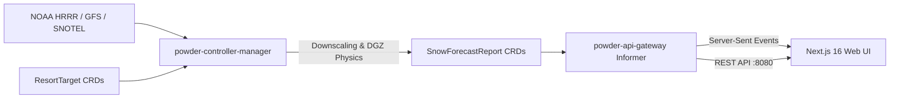

# ❄️ PowderPredictor

[](https://kubernetes.io)
[](https://golang.org)
[-000000.svg?logo=next.dot.js&logoColor=white)](https://nextjs.org)
[](https://maplibre.org)
[](https://tilt.dev)
[](LICENSE)

> **Cloud-native meteorological downscaling and powder intelligence engine for Northeast ski resorts.**
> Powered by a Kubernetes Operator, atmospheric physics, and an interactive MapLibre GL frontend.

---

## 🏔️ Overview

Standard weather forecasts predict flat valley precipitation, completely missing the microclimates of steep alpine topography. **PowderPredictor** reconciles numerical weather prediction (NWP) model outputs against mountain topographical profiles, generating real-time elevation-adjusted snow quality forecasts for **26+ Northeast ski mountains** across Vermont, New Hampshire, Maine, New York, and Massachusetts.



---

## ✨ Key Features

* **Kubernetes Operator Pattern**: Declarative management of mountain targets (`ResortTarget`) and computed forecast reports (`SnowForecastReport`) using Custom Resource Definitions (CRDs).
* **Atmospheric Physics Engine**:
  * **Moist Adiabatic Lapse Rate (MALR)**: Altitude temperature downscaling across base, mid-mountain, and summit tiers.
  * **Dendritic Growth Zone (DGZ)**: Detects $-12^\circ\text{C}$ to $-18^\circ\text{C}$ crystal crystallization zones to accurately compute Snow-to-Liquid Ratios (SLR) up to $22:1$.
  * **Aspect Wind Transport**: Models windward scouring vs. leeward deposition stashes and computes summit wind hold risks.
  * **Unified Powder Score (0–100)**: Multi-factor score factoring accumulation, snow density, thermal crust risk, and wind exposure.
* **Real-Time API Gateway**: Gin-based gateway utilizing Kubernetes Informer caching for sub-millisecond REST reads and Server-Sent Events (SSE) live updates.
* **Interactive Frontend**:
  * **MapLibre GL Canvas**: 60fps vector/raster topography with Dark Matter, USGS Topo, and Esri Satellite basemaps without proprietary tokens.
  * **26-Mountain Northeast Catalog**: Full coverage across VT (Green Mtns), NH (White Mtns), ME, NY (Adirondacks & Catskills), and MA across Ikon, Epic, Indy, and Independent passes.
  * **Resort Matrix Table**: Powered by `@tanstack/react-table`, sortable by Powder Score, 48h snowfall, drive times from 6 metro origins, and SLR.
  * **72-Hour Temporal Scrubber**: Real-time slider scrubbing forward 72 hours, visualizing dynamic freezing level and precipitation phase shifts.
  * **Persona Presets**: One-click toggles for "Deep Powder Hunter", "Wind-Hold Avoider", and "Bluebird Cruiser".

---

## 🚀 Quick Start (Local Kind & Tilt)

PowderPredictor provides a turnkey local developer experience. You can spin up an entire local cluster with CRDs, Ingress, cert-manager, mock servers, and live reload in under two minutes:

### 1. Prerequisites
* [Docker](https://www.docker.com/) or Colima
* [Go](https://go.dev/) (v1.24+)
* [Node.js](https://nodejs.org/) (v20+) & npm
* [Kind](https://kind.sigs.k8s.io/), [kubectl](https://kubernetes.io/docs/tasks/tools/), [Helm](https://helm.sh/), and [Tilt](https://tilt.dev/)

### 2. Launch Local Environment
```bash
# 1. Provision Kind cluster, cert-manager, ingress-nginx, CRDs, and seed resorts
make cluster-up

# 2. Start the inner-loop live reload dashboard
tilt up
```
Press `Space` to open the Tilt dashboard (`http://localhost:10350`). Changes to Go code or frontend components update live containers within seconds.

### 3. Open the Web Application
Visit **`http://localhost:3000`** in your browser to explore the interactive ski map and trip planner.

### 4. Tear Down
```bash
make cluster-down
```

---

## 💻 Standalone Frontend Development

If you only want to work on the UI without running a Kubernetes cluster:

```bash
cd web
npm install
npm run dev
```

The web application runs on `http://localhost:3000` and automatically uses the comprehensive 26-mountain Northeast fallback catalog if the backend gateway is disconnected.

---

## 📡 API Reference

The API Gateway (`powder-api-gateway`) runs in-cluster and exposes the following endpoints:

| Endpoint | Method | Description |
| :--- | :--- | :--- |
| `/api/v1/forecasts` | `GET` | Returns all active mountain forecasts from in-memory Informer cache |
| `/api/v1/forecasts/stream` | `GET` | Server-Sent Events (SSE) stream pushing instant reconciliation updates |
| `/api/v1/resorts/{id}/history` | `GET` | Historical telemetry and model run history for a resort |
| `/healthz` | `GET` | Liveness probe (`200 OK`) |
| `/readyz` | `GET` | Readiness probe (`200 OK`) |
| `/metrics` | `GET` | Prometheus metrics endpoint |

---

## 🧪 Verification & Testing

```bash
# Run Go controller unit & envtest integration tests
make test

# Run frontend TypeScript type checking
cd web && npx tsc --noEmit

# Run automated End-to-End integration smoke test
./hack/e2e-smoke-test.sh
```

---

## 📚 In-Depth Documentation

* 📐 [System Architecture & Design](docs/architecture.md): Deep dive into the Kubernetes Operator, Controller Reconcile loop, and API Gateway Informer caching.
* ❄️ [Meteorological Modeling Engine](docs/meteorological-model.md): Detailed physical formulas for Moist Adiabatic Lapse Rate (MALR), Dendritic Growth Zone (DGZ), and Powder Score calculations.
* 🔌 [API & CRD Reference](docs/api-reference.md): Full REST API contracts, SSE payload specifications, and Kubernetes Custom Resource schemas.
* 🛠️ [Local Development & Tooling](docs/local-development.md): Comprehensive guide to Kind cluster provisioning, Tilt inner loop, and E2E smoke tests.

---

## 📜 License

Licensed under the [Apache License, Version 2.0](LICENSE).
